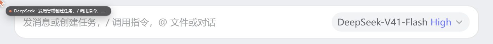
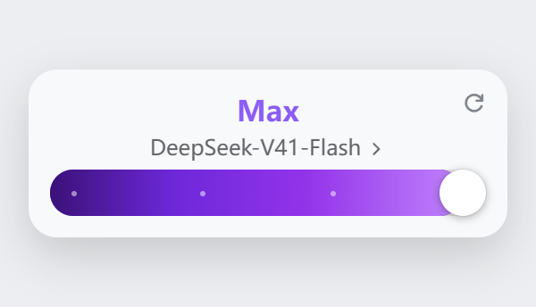
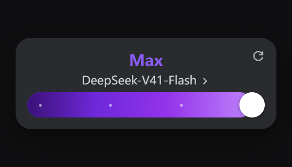
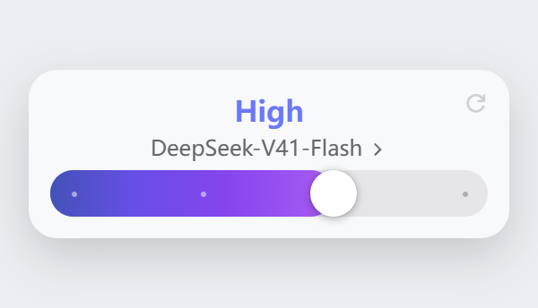
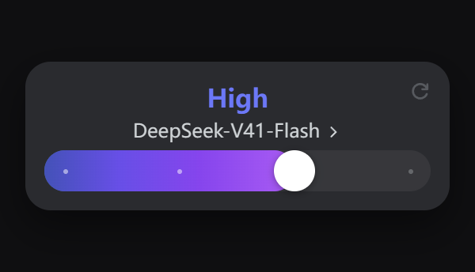
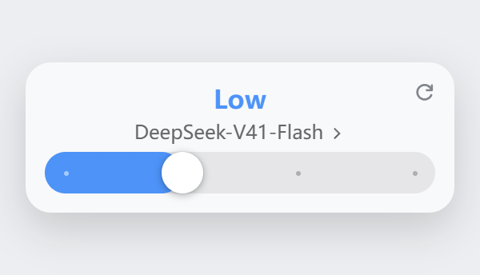
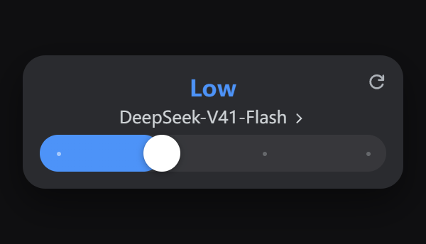
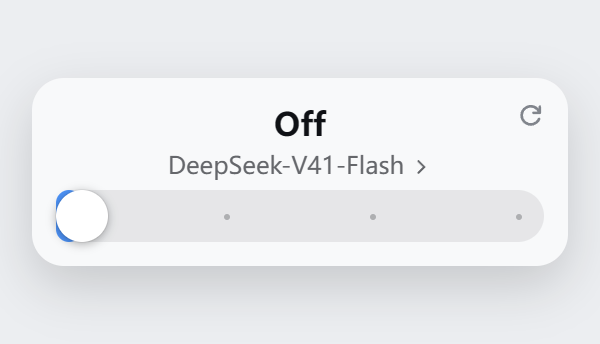
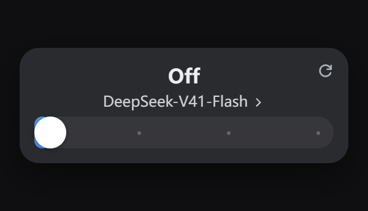

# dsh-codex-effort-slider

给 [DeepSeek Harness](https://github.com/deepseek-ai/deepseek-harness)（DSH）用的 **Codex 风格推理等级滑条**。

**一档一色、越往右越"通电"**：填充从蓝渐变到紫罗兰，高档位亮起紫色星云与星尘粒子，  
官方那个档位名文字本身也跟着变色（`Off` 档保持官方灰）。

## 装好之后长这样

收起态：档位就在输入框里那枚模型席按钮上（胶囊），**点开之前**也按档位着色。



点开模型菜单后（左列浅色主题 / 右列深色主题，四档从上到下）：

| 档位       | 浅色主题                                            | 深色主题                                            |
| -------- | ----------------------------------------------- | ----------------------------------------------- |
| **Max**  |        |        |
| **High** |       |       |
| **Low**  |        |        |
| **Off**  |        |        |

（截图由 `npm run screenshots` 生成源页、再用无头浏览器按**真产物 CSS** 渲染后裁出，不是手工 P 的。）

对比度都算过（最高档的档位名文字：白底 **4.23:1**、深色底 **4.02:1**）。  
**不用安装也能先玩**：浏览器打开 [`preview/panel.html`](preview/panel.html)，可拖动、切浅深色、切 4/2/6 档模型  
（另有脚本生成的实现示意图：[`preview/seat-color.png`](preview/seat-color.png)、[`preview/distribution.png`](preview/distribution.png)）。

它不新增入口：**把官方模型菜单整体重排成一张卡片** ——
顶部是大号档位名（就是官方那一行的 value 文字，跟着滑条位置变色），
下面是「模型名 ›」一行，滑条铺满一行，卡片右上角是插件自绘的「恢复默认档位」按钮；
**上半张（档位名）与下半张（模型名）点哪都进模型列表**，官方那个模型列表**行样式保持官方原样**（圆角矩形）。
拖到最高档时整条轨道亮起紫色能量层。

```
点开官方模型菜单后：
┌────────────────────────────────────┐
│                                 ↻  │   ← 插件自绘：恢复默认档位
│              High                  │   ← 官方「推理等级」那行的 value 文字（放大居中）
│      DeepSeek-V41-Flash  ›         │   ← 官方「模型」那一行（label 藏起来）
│ ●━━━━━━━━━━━━━━━━━━━━━━━━━━━━━━━   │   ← 插件注入的滑条
└────────────────────────────────────┘
输入框工具行：**不加任何东西**；收起态那枚席按钮做成胶囊
```

点卡片上半张或下半张（也就是上面图里带 `↻` 的整片区域），都会进入官方的模型列表 ——
列表**行样式用回官方原样**（圆角矩形、34px 行高、官方内距）；顶部的「搜索模型…」输入框已收起，列表顶部贴住卡片内沿。

鼠标悬停在那片区域上时，卡片里会浮出一个**浅灰圆角胶囊**，把大号档位名与模型名两行都罩在里面
（宽度只包住文字、不铺满卡片，跟着模型名长短伸缩；悬停两行中任意一行都会出现）。
两行文字之间的行距是**收紧过**的：卡片不设 `gap`、上半张不留下内距，只留字体自身的行高 ——
实测两行文字的空隙从 7px 收到 2px，整张卡片高 104px（收紧前行高撑到 96px 的下一档）。
胶囊是**5px 圆角**的圆角矩形（参考图量得 8 源像素 × 268/446 ≈ 4.8），
底边与滑轨之间留 **13px** 间距（参考图等比换算 13.2px），不与滑条相贴。

拖到最高档：轨道变为**紫色星云**（流向渐变 + 扫光 + 22 颗错峰星尘粒子）。

**30 秒上手**：下载/克隆本仓库 → 双击 `install.cmd`（或按下面的「安装」一节）→  
**完全退出并重开** DSH Desktop。

## 安装

> 不想 clone 的话,直接下载打包好的 zip:[**Releases → dsh-codex-effort-slider-1.0.0.zip**](https://github.com/Microqian2th/dsh-codex-effort-slider/releases/latest)。

**只走 DSH Desktop 自己的插件面板**——命令行装不了 `desktop` profile：

```powershell
dsh plugin --profile desktop add link:"F:\Work Space\DeepSeek Harness\dsh-codex-effort-slider"
# error: profile "desktop" is managed exclusively by the Electron application
```

（这不是配置问题：`bin.js` 里对 `desktop` 直接 `program.error`，只有 Electron 应用本人被允许管理这个保留 profile。）

两条路：

1. **面板安装**（推荐）：**设置 → 插件 → 添加插件** → 填本地目录路径 → 安装 → 重启 DSH Desktop。  
   面板会校验两件事，本插件都已满足：是有效的插件包、声明了组合包（`dsh.bundle.patch`）。
2. **手工安装**（当面板本身不可用时——例如 `profileContext` 没挂上，`dsh-base` 会把  
   `plugin-manager` 整行 `disabled`，设置侧栏里就看不到「插件」）：  
   备份 profile 的 `package.json` → 加一条 `link:` 依赖 → `dsh.profile.bundles` 追加本包名 →  
   在 `profiles/<profile>/node_modules/` 下建一个指向本目录的 junction → 重启。

> 卸载用面板；手工装的用 `cmd /c rmdir <junction>`（**不要**用 `Remove-Item -Recurse`，  
> 那可能顺着 junction 把插件目录里的文件删掉）。

想先看观感、不装也行：`node preview/make-preview.mjs` 生成 `preview/panel.html`，  
用浏览器打开即可拖动、切浅深色、切 4/2/6 档模型（页面里连官方菜单外壳都复刻了，  
CSS 与拖动数学都是从真产物抽出来的）。

## 分享给别人

### 打包

```powershell
npm run pack      # = powershell -NoProfile -ExecutionPolicy Bypass -File pack-dist.ps1
```

产出 `dist/dsh-codex-effort-slider-<version>.zip`（约 350 KB）。本插件**零运行时依赖、无构建步骤** ——  
解开就能装，接收方不需要 `pnpm install`。若要让人从 GitHub / npm 装，把**本目录的内容**推到仓库根  
（`package.json` 必须在仓库根，pnpm 才能把它当包解析）。

### 接收方怎么装（三种，按省事程度排序）

1. **面板安装（推荐）**：DSH Desktop → **设置 → 插件 → 添加插件**，填三者之一：
   - **本地目录路径**（解开 zip 后那一层目录）
   - **`github:<用户名>/<仓库>`**（面板会先做一次 GitHub 连接检查，再交给 pnpm 拉取）
   - **npm 包名**（走 registry；DSH 默认已配 npm 镜像作为回退）
2. **命令行**（**只有非 desktop profile 能这么装**）：
   ```powershell
   dsh plugin --profile tui add link:"<插件的绝对路径>"
   dsh plugin --profile tui add github:<用户名>/<仓库>
   ```
   `desktop` 是 Electron 保留 profile，命令行会被直接拒绝  
   （`error: profile "desktop" is managed exclusively by the Electron application`）。
3. **脚本**（desktop profile 且设置里没有「插件」面板时）：
   ```powershell
   install.cmd                    # 装进 desktop
   install.cmd -Profile tui       # 装进别的 profile
   install.cmd -Uninstall         # 卸载
   ```
   `install-profile.ps1` 做四件事：备份 profile 的 `package.json` → 加一条 `link:` 依赖 →  
   把包名追加进 `dsh.profile.bundles` → 在 profile 的 `node_modules` 下建链接  
   （Windows 用 junction，其它平台用符号链接），最后校验这三项都成立。  
   **已用一个假 profile 完整跑过安装与卸载**，并确认卸载只删链接、不会顺着链接删掉插件本体。

### 注意事项

- `link:` 里是**绝对路径**，所以每台机器装完都必须指向自己的目录（面板/脚本会自动写对）。
- 改过 `lib/client.js` 后**必须完全退出并重开** DSH Desktop 才生效 —— 宿主在启动时把插件读进内存，  
  只关窗口不够。
- **卸载**：面板卸载，或 `install.cmd -Uninstall`；手工建过 junction 的用 `cmd /c rmdir <junction>`。  
  **不要**用 `Remove-Item -Recurse`，它可能顺着链接把插件目录里的文件删掉。
- **兼容性**：DOM 锚点全部是官方**语义属性**（`aria-haspopup` / `aria-expanded` / `aria-controls` / `role`）  
  加两个官方 class；哈希前缀不依赖（收起态那段档位文字是**按文字**认的）。官方若改语义，插件  
  **静默不生效**（fail-open），不会把官方界面改坏。本插件**不注册任何宿主钩子、不注入消息**  
  （测试里有 `ctx.on` 监视断言守着这一点）。
- 许可 MIT（见 `LICENSE`）。`package.json` 里现在是 `"private": true`（**要发 npm 得先删掉这一行**）。

## 它怎么工作（两半）

| 半边                   | 干什么                                                                                                         |
| -------------------- | ----------------------------------------------------------------------------------------------------------- |
| `lib/index.js`（宿主）   | 空逻辑 + 一次客户端产物静态核对。存在的唯一理由是让本包成为 cordis 树上的一行，否则 `dsh.client` 的 bundle 不会被扫进启动图                              |
| `lib/client.js`（客户端） | 一个不可见锚点（注册进 `conversation.input.right`，用来拿 `sessionId` 与 `ctx`）+ **DOM 桥**（给官方节点加 class 重排成卡片）+ 滑条（`react-dom` portal 注入官方菜单） |

### DOM 桥依赖的官方锚点（全部是**语义属性**，不是哈希 class）

| 锚点                                                     | 官方产物里的形状                                                               |
| ------------------------------------------------------ | ---------------------------------------------------------------------- |
| 席：`button[aria-haspopup="menu"][aria-expanded="true"]` | `<button aria-haspopup="menu" aria-expanded={open} aria-controls={…}>` |
| 菜单：席的 `aria-controls` → `getElementById(…)`            | 菜单 `id={…-menu}`，portal 到 body                                         |
| 目标行：菜单里 `button[role="menuitem"]` 的**第 2 个**           | 根面板恰好两行（模型 / 推理等级）；子面板用 `menuitemradio`，所以 `menuitem` 唯一标识根面板          |
| 归属判定：从自己的锚点向上找 `[data-composer-card]`                  | composer 卡片带这个标记；打开的那颗席必须在**自己的** composer 里                           |

**只重排、不换节点**：官方那两行与官方列表行，DOM **一个节点都不新建/不删除/不搬动**，
只给它们加一个自己的 class（`ces-head` / `ces-modelrow` / `ces-option` …）改外观；
卡片里的**视觉顺序**（大号档位名在上、模型名在下）用 flex `order` 换位，DOM 顺序仍是官方的 `[模型][推理等级]`。
关菜单或卸载时把 class 逐个摘掉即可完全还原 —— 因此官方的键盘、Esc、焦点、
以及 portal 定位逻辑**全部原封不动**。

**行为改动一共四处**，都只碰官方节点上的**监听器与 DOM 属性**，不新建/不搬动官方节点：

1. 在「推理等级」那一行上装一个**捕获阶段**的原生 `click` 监听（`guardRow`），
   `stopImmediatePropagation()` 掉它 —— 官方 drill 进等级列表的唯一入口就是这个 `onClick`，
   拦掉之后那张 Default/Low/High/Xhigh 卡片永远不会出现，滑条成为唯一的档位控件。
   必须挂在**那一行自己**身上（React 17+ 的 `onClick` 委托在 portal 容器的冒泡阶段，
   挂祖先会排到 React 之后）。只拦 `click`：`pointerdown` / `pointerup` / `keydown` /
   `mousedown` 一概不碰，官方根面板的 ArrowDown/Up 焦点移动、Tab 顺序、Esc 关菜单全部照常。
   拦下之后**转发**给「模型」那一行（`guardRow(head, modelRow)`）：卡片上半张是大号档位名、
   下半张是模型名，本来就是同一个视觉整体，点哪都该进**模型列表**。转发是「先摘守卫 →
   `target.click()` → 立刻挂回」，摘掉是为了不让自己转出去的 click 又落回自己（无限递归）。
   那一行因此是 `cursor:pointer`，并用一个透明 `::after`（`top:100%;height:2px`）把上半张底边
   那 2px 字体空白补上 —— 用户框选的是一整片区域，而那 2px 本来不属于任何一行、
   点了什么都不会发生。（只补 2px：下半张本来就整行可点，补多了会反过来盖住下半张的文字。）
2. 在菜单本体上装一个**捕获阶段**的 `keydown` 守卫（`guardKeys`），只拦可打印字符
   （`key.length === 1` 且无 Ctrl/Meta/Alt）—— 配合搜索框的 `readOnly`，
   让"搜索输入框不再能吃字"，同时不碰任何导航键。详见下面「菜单尺寸与列表」一节。
3. 给列表容器装一个 `scroll` 监听（`watchGroupHeads`）与菜单本体装一个 `ResizeObserver`
   （`settleMenu`）—— 前者给贴顶分组标题补底色，后者在尺寸变化后让官方 `place()` 重测定位。
4. 放宽 ↻ 的可用条件（`resetTargetOf`）：旧逻辑要求目录必须给出 `reasoning.defaultEffort`，
   否则**不渲染按钮**；现在目录没给（或给的 id 不在档位表里）时也渲染，点了走**提供商默认**
   —— 官方模型列表在同样情况下就是这么补一项的（`effort.providerDefault`，提交不带 `reasoningEffort`）。
   本机 trae 那批模型目录里只有 `efforts`、没有 `defaultEffort`，旧逻辑下卡片右上角永远空着，
   与参考图不符。容器上因此多一个 `data-reset-kind="level|provider|none"` 标记。

所有监听随 `detach()` / `dispose()` 摘掉，官方节点上不留任何我们的监听。

**fail-open**：任何一步认不出（没有 `aria-controls`、不是根面板、不是自己的 composer、
目录里没有档位、会话作用域没就绪）就把 class 与容器全撤掉 —— 官方菜单保持原样，绝不会因为本插件点不开。

### 菜单尺寸与列表（四项改造）

官方菜单本体（`_7KE1Ra_menu`，root / model / effort 三个面板**复用同一个 portal 容器**）
拿到 `ces-surface`：`box-sizing:border-box` + `width:min(268px, 100vw − 32px)` + `padding:12px`。
宽度与内距**必须打在这个容器上而不是卡片上** —— 官方菜单默认是 `content-box`，
旧写法把 `width:268px` 写在卡片上，实际外框 268 + 12×2 = **292px**；而点进「模型」后
卡片 class 被摘掉，回落官方的 `width:max-content`（240px 内容宽），于是面板**从 292 突变到 248**，
官方 `place()` 又是右对齐定位（`x = rect.right − lw`）→ 整块重锚，视觉上就是"跳一下"。
统一到菜单本体后 root / model / effort 三个面板**永远同宽**，窄视口（320px）也不再溢出
（旧写法实测 `left = −4`，卡片半个身子在窗口外）。

- **搜索框收起**：官方是否渲染搜索行只由 `choices.length > 4` 决定（React 里的常量判定，
  插件改不了），所以只能从 CSS 下手。做法是给搜索行 `ces-searchrow`：
  `position:absolute` + `1px×1px` + `clip-path:inset(50%)` + `opacity:0` + `pointer-events:none` ——
  **占 0 布局空间但仍可聚焦**。为什么不能直接 `display:none`：官方所有键盘分支都以
  `showSearch` 为条件、且都指向那颗 input（drill 后 `searchRef.focus()`、ArrowDown/Up 在 input 里
  移高亮、Enter/Tab 在 input 里选中、Tab-from-trigger 也是聚焦它），`display:none` 会让这些聚焦全部
  落空、键盘导航卡死。保留可聚焦 = 官方键盘行为**零改动**。另外给它加 `readOnly = true`
  （随 `scan()` 重写，因为 React 的 `readOnly` 是受控 prop 会覆盖），再在菜单上挂一个捕获阶段的
  `keydown` 守卫拦掉可打印字符 —— 于是"能键盘导航、但不能打字过滤"，正是需求要的。
- **列表行用回官方样式**：`.ces-option{border-radius:var(--dsw-radius-md,12px);min-height:34px;padding:5px 7px;gap:6px}`
  —— 这四个值本来就是官方 `._7KE1Ra_option` 的，这里**显式写回**（不是改造）：同一个元素上我们的
  class 与官方哈希 class 优先级相同、两张样式表先后不确定，显式声明才能确定地拿到官方外观。
  选中态也交还官方（官方 `._7KE1Ra_selected{background:0 0}`，只靠行尾对勾表示「当前」），
  插件以前铺的那层 `--dsw-alias-interactive-bg-hover` 底色整条规则已撤掉。纯 CSS，不给行加新 class ——
  测试里有 `className` 全等断言。
- **悬停胶囊**：悬停「档位名 + 模型名」那片区域时浮出一个浅灰圆角矩形（参考图效果）。
  它必须**纯 CSS**（同上：不能加节点、不能加 class），所以画成
  `.ces-modelrow>span:nth-child(2)::after` —— 挂在**模型名那个 value span** 上。
  选它的原因：span 是 `flex:0 1 auto` 的**内容宽**盒子（实测 149px，卡片内容区 244px），
  于是胶囊跟着模型名贴身伸缩、在卡片里居中；绝对定位 + 负偏移
  （`top:-25px` / `bottom:-1px` / `left:-12px` / `right:-26px`）把上一行「档位名」与右侧
  雪弗龙都罩进来（实测胶囊高 42px、水平居中于卡片、圆角 5px —— 参考图 8 源像素 × 268/446）。
  `bottom:-1px` 是关键：`-4px` 会让胶囊往下多长 3px，把滑条上方那 12px 间距吃掉一大半
  （实测只剩 10px）—— 收到 `-1px` 后间距 13px，与参考图等比一致。触发用 `:hover` + `:has(.ces-head:hover)`（官方 DOM 顺序是
  `[模型行][推理等级行]`、视觉上档位名在上靠 `order:-2`，兄弟选择器只能向后匹配，
  所以跨行必须 `:has()`）。`z-index:-1` 让它落在菜单材质层之上、文字之下；
  `pointer-events:none` 保证不吃点击。同时要**中和官方铺满整行的 hover 底色**
  （`.ces-modelrow:hover{background:0 0}`）—— 否则会跟贴身胶囊叠成两层。
  ⚠️ 还有一处必须覆盖：官方 `.cellValue` 带 `overflow:hidden`（给超长模型名做省略号用的），
  会把挂在 span 上的伪元素连负偏移一起裁掉（实测只剩 149×16），
  所以 `.ces-modelrow>span:nth-child(2)` 要写 `overflow:visible` —— 卡片内容区 244px、
  实测最长的模型名 202px，离省略号还远，去掉裁剪不影响观感。
- **贴顶分组标题**：官方列表有粘性分组头（`[data-menu-group-heading]`），但官方的
  `observeStickyMenuGroups` 靠"列表顶 1px 条"判定 `data-stuck`，插件原来的
  `.ces-list{padding:2px 0}` 把 section 顶推到 2px，**恰好越过那条判定带** → 贴顶标题永远没有底色、
  文字直接压在滚过的行上（就是"拥挤/压字"）。现在 `.ces-list{padding:0}` 归零，并且插件自己给
  贴顶标题补一个不依赖官方观察器的底色：`paintGroupHeads(list)` 在列表 `scroll` 时算
  `heading.top <= listTop + 1 && section.bottom > listTop + 1`，命中就写 `data-ces-stuck`，
  CSS 里 `.ces-grouphead[data-ces-stuck]{background:var(--dsw-alias-menu-group-header-fill)}`。
- **重新定位**：官方 `place()` 只在 `[open, pane, state, query]` 变化或 window `resize` 时重算。
  插件原来在 `scan()` 里派发**一次** `resize`，但那一刻滑条/列表尺寸还没落定 ——
  实测根面板底边压住触发器 **22px**（官方基准是 `trigger.top − 8`，即 gap `+8`）。
  改成 `settleMenu(menu)`：用 `ResizeObserver` 盯住菜单本体，**尺寸一变就重测**（有 RO 用 RO，
  没有则退化为挂载时派发一次）。实测 gap 从 `−22` 修正到 `+8`，且只触发一次、不抖动。

### 「恢复默认档位」按钮

卡片右上角那个 ↻ 是插件自绘的（官方没有这个按钮），目标分两种情况，都照**官方模型列表自己的语义**：

- 目录给了 `reasoning.defaultEffort`、且这个 id **确实在当前档位表里** → 写回那个档位 id。
  官方在档位列表里就是把它当成普通档位列出来的（带默认档自己的名字）。
- 目录**没给**默认档，或给的 id 不在档位表里 → 清空显式档位、交回**提供商默认**。
  官方在同样情况下会往档位列表里**补一项**「提供商默认」（文案键 `effort.providerDefault`），
  提交的是 `select({provider, model})` —— **不带** `reasoningEffort`；插件照抄同一套
  （`flush()` 里对 `PROVIDER_DEFAULT_ID` 走的就是这个分支）。没有这条回退，
  本机 trae 那批模型（目录里只有 `efforts`、没有 `defaultEffort`）卡片右上角就永远空着。

模型**压根没有推理能力**（目录里没有 `reasoning` 元数据，也就没有档位表）时才不渲染按钮 ——
那时没有"默认档"可言。已经在目标上（同档位 / 本来就没显式设置过档位）时按钮置灰。
容器上带 `data-reset="1|0"` 与 `data-reset-kind="level|provider|none"` 两个标记。

## 数据路径（只用官方公开面）

| 用途  | 接口                                                                                    |
| --- | ------------------------------------------------------------------------------------- |
| 读档位 | `directoryFor(sessionId).store.getSnapshot()` → `groups[].models[].reasoning.efforts` |
| 写档位 | `directory.select({ provider, model, reasoningEffort })`（与官方菜单同一写入口）                  |
| 订阅  | `store.subscribe()` + `React.useSyncExternalStore`                                    |

## 色彩与粒子（**由位置连续驱动**，与档位数无关）

拖到哪，颜色与粒子就跟到哪。三个纯函数（都有断言）：

| 位置 `pct`  | 颜色 `fillColorFor` | 能量 `energyFor` | 粒子数 `particleCountFor` | 速率 `speedFor`         |
| --------- | ----------------- | -------------- | ---------------------- | --------------------- |
| 0（第一档）    | 蓝 `#4d93f8`       | 0              | 0                      | 0.35×                 |
| 1/3（第二档）  | 蓝（**第一档到第二档恒为蓝**） | 0              | 0                      | 0.35×                 |
| 2/3（high） | 紫 `#9333ea`       | 0.5            | 11 / 22                | **1×（就是"现在这个速度刚刚好"）** |
| 1（max）    | 深紫 `#4c1d95`      | 1              | 22 / 22                | **2×**                |

- **颜色**：填充层是 `linear-gradient(90deg, 蓝, 当前位置的颜色)` —— **左端恒为蓝、右端是当前位置的颜色**，  
  所以 high 档自然呈现"左蓝右紫"，越往右右端越深（深紫 `#4c1d95`）。
- **能量层**（紫色星云 + 扫光）强度 = `energyFor`，它在第二档以前是 0 —— 所以左半段是**干净的蓝**，  
  往右才逐渐"通电"。**"通电"的反馈只留在轨道内部**（星云/粒子/扫光），不再往官方那一行描紫边 ——
  那一行现在是卡片顶部的标题，描边会变成给标题画框。
- **轨道没有外发光**（用户要求去掉滑条的投影）：原来有一条
  `.ces-inline[data-energy='1'] .ces-track{box-shadow:0 0 16px rgba(168,85,247,.5)}`，
  在轨道外面糊一圈紫晕；已删除。参考图（ChatGPT 的强度弹层）实测轨道外一圈就是卡片底色，
  没有任何光晕 —— 本机截图也验证过：删之前轨道上方 2px 是 `rgb(73,58,102)`（卡片底色
  `rgb(21,27,35)` 被紫晕提亮），删之后那一圈回到卡片底色。  
  ⚠️ 紧挨着它的 `.ces-inline[data-energy='0'] .ces-star,...{animation-play-state:paused}` **不能一起删** ——
  那条管的是粒子动画的启停（关档时不让 22 个隐形元素白烧 GPU），跟光晕是两件事。
- **能量条只覆盖已填充那一段**：能量层宽度与填充层完全相同（都到旋钮圆心），  
  所以**档位右边没达到的部分不会出现能量条**，只剩轨道底色。
- **Off 档在"两个界面"里都保持官方灰**（`isOffLevel` + `valueColorFor` 返回**空串**）：  
  Off 档时既不给卡片顶部那个档位名上色，也不给收起态席按钮上的档位文字上色 ——  
  空串 = 不写内联色 = 官方原本的颜色。档位是不是"关"按 **id 和 name 都认**（`off`/`none`/`关闭`/`无`，  
  大小写与空格不敏感；DeepSeek 的真实档位表见 `dsh-llm-deepseek/lib/index.js` 的 `REASONING_EFFORTS`）。  
  Off 档本身也没有能量层（energy 0 → 纯蓝、无星云、无星尘）。
- **刻度点更小更淡**（用户要求）：`5px → 3px`；已达刻度 `rgba(255,255,255,.92) → .5`，  
  未达刻度 `color-mix(... 38% → 26%)`。改小改淡之后它们不再和星尘粒子抢眼。
- **星空（所有出现粒子的档位都用这一套，动画已统一）**：
  - **不消失**：外层是一条**整轨宽度**的轨道，自己在做 `translate3d(-100%)` 的连续横穿；  
    残影只在 0%/6% 与 94%/100% 淡出淡入 —— 那两端在可视区外，所以看起来星星**从不消失**。  
    （旧的"短掠过 + 原地淡出"那套逻辑与 CSS 已整体删除，有断言守着 `.ces-particle` / `ces-drift` 不再存在。）
  - **亮度随机、越亮越大**：每颗的亮度/大小系数由确定性伪随机给出，落在 **0.5 ~ 1** 之间  
    （1 = 3px 与亮度 100%）；圆点用 `opacity:var(--ces-b)` + `transform:scale(var(--ces-b))`，  
    所以"亮的那颗同时更大"。
  - **速度随位置变化（保留）**：横穿时长 = `STARFIELD_DURATION_MEAN × MAX_SPEED_FACTOR / speedFor(pct)`  
    —— **MAX 档 1.5s、high 档 3s、第二档附近约 8.6s**（位置速率 2× / 1× / 0.35×）。
  - **星星单独一层，不跟星云淡入**：星云层（紫色渐变 + 扫光）的透明度 = 能量强度，high 档只有 0.5；  
    若星星套在里面，每颗的实际不透明度会被压到 0.25~0.5，在紫色底上几乎看不见  
    （用户实测反馈"high 档一打开几乎没粒子"）。所以星星放在 `.ces-stars` 独立层，  
    透明度 = `starLayerOpacityFor`（high 档 **0.8**、MAX 档 **1.0**），"逐渐出现"交给**粒子数**表达。  
    **MAX 档观感与之前完全一致（都是 1.0），没有动。**
  - **各星之间只差 ±8%**（`STARFIELD_DURATION_SPREAD`）：保留"有的稍快有的稍慢"的层次，  
    又不会像原来 0.95–2.05s（速度差 **2.16×**）那样快星追上慢星排成一队。
  - **高度 = 随机排列的等距槽位，并与相位解耦**（8%~92% 用满轨道高度）：  
    早期版本高度和相位**取自同一个数** `frac((i+1)×φ)`，于是"越靠右的星越高"，22 颗排成  
    一条斜线（用户实测反馈"太规整，再随机一点"；高度↔相位相关系数实测 **0.999**）。  
    现在高度是一条**确定性随机排列**（哈希排序，不用 `Math.random`），并自动挑一个盐值  
    保证**相位相邻**（会一直并排在轨道上走）的两颗至少差 **28%** 轨道高，不会并成一坨。  
    相关系数实测 **−0.110**（有断言守着 `|r| < 0.35` —— 旧版会直接失败）。
  - **相位只跟 index 有关、跟"当前显示几颗"无关**（黄金比低差异序列，任意前缀都铺得开）：  
    拖动改变粒子密度时不会改写已挂载动画的 `animation-delay`，所以**进档那一下不会被整体重排**。
  - **时长与相位直接内联**写在元素上（`animationDuration` / `animationDelay`），  
    **不走 CSS 变量**：真引擎实测（无头 Chromium 逐帧读 `getComputedStyle`）两种写法相位都成立，  
    但内联更少一层不确定性，"减少动态效果"的放缓也顺势改到 JS 里算（`REDUCED_MOTION_SLOWDOWN`）。
  - 伪随机是**确定性**的（`starHash01`，不用 `Math.random`）：重渲染不跳变，且可离线断言。

**"聚集"的量化对照**（模拟真产物参数，轨道 300×26px，两星中心距离 <6px 记为粘住）：

| t=0.2s（刚进档）   | t=0.4s        | t=1s      | t=2s      | t=3s          |
| ------------- | ------------- | --------- | --------- | ------------- |
| 3 对 → **0 对** | 1 对 → **0 对** | 4 对 → 2 对 | 7 对 → 4 对 | 4 对 → **0 对** |

**长期行为（如实标注）**：只要每颗星的时长不完全相同，相位就会**缓慢互相错开**，最终趋近随机分布  
（22 颗里总会有几对偶尔靠近）。实测粘住对数随每颗星时长浮动变化：

| 每颗星时长浮动     | t=0.5s | t=1s  | t=2s  | t=5s  |
| ----------- | ------ | ----- | ----- | ----- |
| **±8%（当前）** | 1      | 7     | 9     | 17    |
| ±4%         | 0      | 2     | 7     | 10    |
| ±2%         | 0      | 0     | 2     | 11    |
| **0%（全同速）** | **0**  | **0** | **0** | **0** |


也就是说：**想彻底永不聚集，就把 `STARFIELD_DURATION_SPREAD` 设成 0**（代价是所有星速度完全一致，  
少了"有的快有的慢"的层次）；保留 ±8% 则偶尔会有几颗靠近一下再分开。这个数字由常量控制，随时可调。

- **卡片顶部那个大号档位名（"Max" / "High"）也会跟着变色**（`valueColorFor`）：  
  与能量同源，**蓝 → 靛 → 紫罗兰**，越往右越"通电"。写的是内联 `color`（内联优先于官方样式表），  
  关菜单时由桥还原；**文字内容一个字都不碰**（断言：内容仍归官方管，官方那两行的 DOM 一个节点不换）。  
  终点色 `COLOR_TEXT_VIOLET = #8b5cf6` 是**照着对比度挑的**：白底 **4.23:1**、深色底(#1b1c20) **4.02:1**，  
  两种主题都读得清（先试过更亮的 `#c084fc`，浅色主题只有 2.6:1 发虚；测试里有对比度断言挡着）。  
  **Off 档例外：不上色，保持官方灰**（见上）。
- **收起态的模型席按钮**（`DeepSeek-V41-Flash  High  ⌄`，**点开菜单之前**就看得见那个档位）同样着色：  
  官方那一小段文字是 `triggerEffort` 这个**哈希 class**（前缀随构建变，靠 class 认迟早失效），  
  所以按**文字**认 —— 官方 trigger 里的文字就是档位的 `name`，和我们从目录读到的是同一份数据  
  （已对照官方源码 `dsh-client-ui-model-selection/lib/client.js:860-867` 确认那是个 `<span>`）。  
  传的是**全部档位名**而不是"当前那个"：档位刚切换、官方还没重渲染席按钮时文字还是旧的，  
  只认当前名字会在那一瞬间掉色。
  - 席上显示的是**已生效**档位，所以拖动过程中它不跟着草稿跳，提交后才变（有断言）。
  - 官方重渲染换了节点 → 桥在重新抓到的那一刻立刻补色（不必等 React 再渲染一次）。
  - 组件卸载时还原；认不出任何已知档位名就**什么都不做**（fail-open：绝不动模型名等别的文字）。
- **`prefers-reduced-motion`**：**放缓而不是冻住** —— 收起扫光、粒子周期 ×2.6，并在滑条的 `title`  
  里说明原因（冻成静态图会让"能量在流动"这个表达整个消失）。
- **配色跟随主题**：轨道底色用 `--dsw-alias-border-l1`；浅色/深色都自动跟随。

## 旋钮几何（顶头适配）

旋钮是**正圆，直径 = 轨道高度**（`TRACK_HEIGHT = KNOB_SIZE = 26px`），  
圆心只在 `[13px, 宽度 − 13px]` 之间移动：

```
left = calc(13px + pct × (100% − 26px))     ← 旋钮、填充终点、刻度共用这一个几何
```

所以 `pct=0` 时圆心落在左端圆角内、`pct=1` 时落在右端圆角内，圆**永远是完整的圆**  
（之前圆心跑到两端之外，圆被官方菜单的 `overflow:hidden` 切掉右半边，  
看起来就像个圆角方块 —— 这也是把直径加大到与轨道同高的原因）。  
指针映射也用同一套内缩几何（`pctAt`），所以拖到最左/最右必定命中端点档位。

## 稳健性（每条都有断言）

- `directoryFor()` 在会话作用域就绪前**按设计抛错** → 退避重试（60ms 起，约 9 秒）+ 自愈；  
  档位数是**后到**的，桥会在档位数变化时主动重扫（DOM 不会因为 store 变化而产生 mutation）。
- 写入失败 / 超时（10s）→ 回滚到真实档位并显示原因，**不谎报成功**。
- 拖动写入有**同档位去重 + 在途合并 + 120ms 降频**：1 秒内 60 次拖动最多 3 次写回，  
  落在当前档位时 0 次；松手必定落地。
- 滑条吞掉自己的 pointer/click/方向键事件，**不会误触官方那一行的 onClick**（那会跳进等级列表）。
- 组件卸载时清掉降频定时器；桥卸载时把所有加给官方节点的 class 逐个摘掉并移除容器，
  连**加在那一行上的原生 click 监听**也一并摘掉（官方节点上不留任何我们的东西）。
- **官方「推理等级」那张卡片（Default / Low / High / Xhigh）不会再出现**。那一行的 `onClick`
  是官方 drill 进等级列表的**唯一入口**，本插件在那一行上用**捕获阶段**的原生 click 监听
  `stopImmediatePropagation()` 把它拦下：React 17+ 把 `onClick` 委托到 portal 容器的冒泡阶段，
  所以挂在祖先上会排到 React 之后（等于白挂），必须挂在那一行自己身上。鼠标、Enter/Space
  （浏览器合成的 click）、以及官方 Tab 处理里的 `focused.click()` 三条路径全覆盖；只拦 click，
  pointerdown/pointerup/keydown/mousedown 一概不碰 —— 官方根面板的焦点移动、Tab 顺序、Esc 关菜单、
  portal 定位全部照常。拦下之后**转发**给「模型」那一行，于是**卡片整片区域（大号档位名 + 模型名，
  含上半张补出来的那 2px）点哪都进模型列表**。那一行自己留着当卡片的大号档位标题（CSS 早已把它
  做成静态标题：无 hover 底色、雪弗龙隐藏），只是指针改成了 `cursor:pointer` —— 它现在真的可点。
  滑条因此成了唯一的档位控件。
- 万一还是进了子面板（比如官方换了实现），滑条卡片整个撤掉。官方菜单是同一个 portal 容器在
  root / model / effort 三个面板间复用（`documentElement.contains(menu)` 在三个面板里**永远为 true**），
  所以「卡片还在不在」必须逐块确认（那两行 + 容器是否还是菜单的子节点），
  不能只看菜单在不在文档里 —— 否则滑条会和官方等级列表叠在一起，而滑条本来就能调等级，那个列表就是多此一举。
  撤滑条**不等于**撤列表重排：模型列表的行重排照样在（`restyleList` 独立于卡片，
  且必须排在 `detach()` 之后，否则被 `clearListCls()` 冲掉）。撤滑条时 click 守卫一起释放，
  返回根面板后重新挂上。

## 开发

无构建步骤：`lib/client.js` 就是发布产物（手写、可读，`require("react")` 与 `require("react-dom")`  
走宿主模块表的平台种子词）。

```powershell
npm test          # 离线断言套件（471 项：几何/色彩/星空/卡片重排/重置/失败回滚/无注入回归/子面板切换/click 守卫与转发/菜单尺寸与列表/悬停胶囊）
npm run preview   # 生成 preview/panel.html（免安装就能玩的观感预览）
npm run screenshots  # 生成 preview/screenshots-src.html（README 那 9 张图的源页）
```

测试台 `test/harness.mjs` 里有一份**保状态**的 React 桩、够用的假 DOM（含 portal、MutationObserver、
`classList`、多属性选择器）、以及一个**假官方菜单**（形状逐字对齐官方产物，含模型列表子面板）。
本机没有可离线使用的真 React（`app.asar` 里不带），所以渲染层是桩件驱动的；
数据路径与 DOM 注入路径跑的都是真代码。

`classList` 必须做真：卡片重排**只靠加/摘 class**（不换节点、不写内联样式），
所以"加上去了吗/摘干净了吗"这类断言全靠它，桩件不真就会假通过。

第 12 节断言会**直接读解包出来的官方产物**校验那 4 个语义锚点还在（`aria-haspopup` / `aria-expanded` /
`aria-controls` / `role="menuitem"` + 官方文案 + `resize` 重测），官方改版导致锚点漂移时会先炸测试，
而不是静默失效。本机没有解包产物时该节自动跳过。

**粒子效果受回归保护**：全部星空/能量相关的 CSS 规则与 17 个纯函数（`fillColorFor` / `energyFor` /
`speedFor` / `particleCountFor` / `starBrightnessFor` / `starDurationFor` / `starDelayFor` / `buildParticles` …）
在这一版里**逐字节未改动**，第 10 节的断言守着它们。

## 已知限制

- 需要重启 DSH Desktop 才生效（客户端 bundle 在启动时注入）。
- 控制项活在官方菜单里，所以**必须先点开模型菜单**才能改档位；输入框工具行上没有常驻读数。
- 依赖官方菜单的 DOM 语义属性。官方若改成非 `menuitem` 结构、去掉 `aria-controls`、  
  或不再用 `data-composer-card`，本插件会**静默退回"什么都不做"**（官方菜单照常可用）。
- 卡片比官方原来的两行菜单更高（多了滑条一行）；官方会自己重测位置并夹取，但极小屏幕上仍可能出现
  菜单贴边（官方自身的 `max-height` 与夹取逻辑仍在）。
- 主题令牌缺失时回退到中性灰 + `#4d93f8` 蓝，观感可用但不如在 DSH 内贴合。

## 许可

MIT。无第三方代码：闪电标/雪弗龙是自己画的路径，粒子层是自己写的 DOM/CSS。
